# 高中数学知识图谱（奕思 Geek&Chalk）分析报告

> **注意**：这是对**外部产品**的逆向分析，不是本仓的计划。我们的现状与计划见 `docs/STATE.md` 与 `docs/plan/2026-10-28-competitor-parity.md`。


> **这份文档是什么**：对一个已上线的教师向「高中数学知识图谱」产品的逆向分析，基于两条作者本人发布的操作视频（画面 OCR + 语音转写），目标是**提炼可复用的做法**，作为 math-coach（北京初中数学个人教辅）重建时的参考基线。
>
> **不是什么**：不是源码分析（该项目**未开源**，作者 GitHub `EasonZhangyichen` 名下 6 个仓库均无图谱相关代码），不是效果评测，不是竞品情报。
>
> 采集日期：2026-10-27（教师版 / 制作手记）＋ 2026-10-27 晚（手机版复盘，§11）｜ 图片目录：`docs/ref/2026-10-kg-teacher-video/`（19 张，4.00 MB）、`docs/ref/2026-10-27-kg-mobile/`（9 张，0.71 MB）
> 图片全部来自视频关键帧，**含 OCR 错字**，引用时保留 OCR 原文并在括号内标注我的判读。

---

## 0. 摘要（先读这一页就够）

### 0.1 这是什么产品

一个**面向教师与学生的「分层知识网络」网页应用**，覆盖上海教材高中数学（必修一/二/三 + 选择性必修一/二）。它不卖题、不做题库，只做一件事：**把「知识点—方法—教材位置—核心素养」四类东西连成可点击、可回溯的图**，并且每个节点都必须能翻回教材原页。

作者自己的定位（口播）：「只有做出了更细的知识和方法性联系，后续题目分析、出卷、素养评价、学生画像、判断学生到底哪里出的问题，才可能足够精准。」

### 0.2 规模口径（三个数字互相不一致，必须分清）

| 口径 | 数值 | 出处 |
| --- | --- | --- |
| 全图节点 / 联系 | **940 节点 · 3,535 条联系** | 教师版界面角标（另有画面闪出「3543」字样，疑为旧版或不同口径） |
| 五册知识点合计 | **421 个**（113 + 84 + 95 + 76 + 53） | 左侧「选择一本教材」 |
| AI 给出的候选联系总量 | **「两万多个」** | 口播 |
| 人工实际核改 | **「大概只有几百个左右」** | 口播 |
| 作者投入 | **「前前后后真的需要花我一个月的时间」**，且「没办法做 SOP」 | 口播 |

**这组数字是整份报告里最有价值的一条信息**：AI 产两万量级、人只认几百条、最终图上三千多条，说明该产品的价值不在「生成」，而在**筛选与核验**——成本结构是「人挑 AI 的活」，不是「AI 替人干活」。421 与 940 的差额（519）我未能从画面上解释（可能把方法节点、主题节点、跨册复用节点都计入，也可能是全学科口径），**这一项标为待解，不做推断**。

### 0.3 它比常见「AI 生成知识图谱」强在哪（五条差异化）

1. **五层分离**：素养 / 教材 / 章节 / 知识 / 方法，各自可筛选、可定位，不是一张糊在一起的图。
2. **教材位置是硬字段且可多值**：一个方法能同时挂在「选择性必修一·第1章+第2章」「必修第二册·第8章」「必修第一册·第2章」三处，并且能点开 PDF 原页（带 ISBN、版次、页码、图号）。
3. **方法是一等公民，不是知识点的属性**：方法有自己的详情页、自己的前置/后续、自己的素养关联，还有一句**边界声明**：「该……只覆盖求轨迹方程，**不代表坐标法的所有应用**」。
4. **边的语义分两种且在图例里写明**：「实线：解题可用」「虚线：使用知识」——即「方法能解哪些知识点的题」与「知识点解题时要调用哪些方法」是两个方向，不能混。
5. **全流程留痕且拒绝自动采纳**：「待核问题继续循环，**不随整理自动采用**」「留存：核对后的内容，连同出处与修改记录」。

### 0.4 对我们的三条直接结论

- **它的信息架构可以整套借**，成本主要在数据（教材定位、方法前后置），不在代码。
- **它的产能不可复制**：一个月纯人工、无法 SOP。我们只能用「AI 播种 + 人工抽检 + 状态机标注」换产能，并接受覆盖率低。
- **它的顺序跟我们相反**：先有图谱、后接诊断。我们现在是「题库 + 诊断」，图谱是补的。这条差异决定了不能照搬它的数据模型粒度（见 §9.4）。

### 0.5 手机版复盘带回来的四条（详见 §11）

第三片录屏是**同一产品的迭代版**（10 分 27 秒，竖屏），它没有推翻前面的判断，但补了四件前两片没露出来的事：

1. **思想升格**：搜索框从「找知识、方法、章节或标签」改成「找知识、**思想**、方法或章节」，思想有了独立详情页与跨章作用域。这条直接指出我们模型里最空的一块——15 条思想、151 条 `belongs_to`，却没有「两个知识点因同属一个思想而可类比」的边。
2. **课标要求下沉到每个知识点**：「知识要求与考核水平」直接引课标原句（「借助函数图象，会用符号语言表达函数的单调性、最大（小）值，理解它们的实际意义」）。我们有 627 条课标条目，但点与课标之间没有引用边。
3. **题目按用途五分**：方法应用 / 定义 / 情境 / 方法对照 / 例题，且五类相加正好等于总数（1+1+11+2+19=34）。我们只有难度档与来源，缺「为什么收这道题」。
4. **他自己承认的边界**：明确说不做初中版，理由是「我没教过初中，怎么知道这个节点是否可靠；方法与思想怎么核对、怎么迁移」。这是对本项目最直接的一次外部批评，我们的应对只能是「可回指 + 显式未核」，而不是宣称可靠。

---

## 1. 信源、采集方法与三条硬限制

### 1.1 信源

| 信源 | 地址 | 用途 | 状态 |
| --- | --- | --- | --- |
| 抖音原片 | `douyin.com/video/7699419705265769766` | 用户给的入口 | **取不到**（网页与 iteminfo API 均 fetch failed） |
| B 站同源片 A | `BV1mFH46CERw`（cid 42485416634，231s，2026-10-03） | 教师版界面全貌 | 720P 已下载 |
| B 站同源片 B | `BV1URJR6XEXY`（cid 42873848682，410s，2026-10-17） | 制作手记（从 0 到 1 全流程） | 720P 已下载 |
| 作者 GitHub | `github.com/EasonZhangyichen` | 找源码 | 6 个仓库，**无图谱项目** |

两片同账号（UP：奕思Geek_Chalk，mid 3747564119657073），B 站简介亦自述「解决了分析教材中的幻觉和匹配问题」，与抖音文案同源。

### 1.2 采集链路（可复现）

```bash
# 1) 元信息
curl 'https://api.bilibili.com/x/web-interface/view?bvid=BV1URJR6XEXY'
# 2) 直链（qn=64 → 720P durl，无需 wbi 签名）
curl 'https://api.bilibili.com/x/player/playurl?bvid=BV1URJR6XEXY&cid=42873848682&qn=64&fnval=0&fourk=1'
# 3) 下载必须带 Referer，否则 403
curl -e 'https://www.bilibili.com/' -o how.mp4 '<durl 地址>'
# 4) 抽帧（本机无 ffmpeg，用 pip 装的 imageio-ffmpeg 自带二进制）
#    teacher 每 4s 一帧（58 张）、how 每 5s 一帧（82 张）
# 5) 放大 1.8x（720x960 → 1296x1728）后 OCR，识别率显著提升
# 6) WinRT OCR（PowerShell 5.1 + Windows.Media.Ocr）
powershell -File out/video/ocr_batch.ps1 -Dir <帧目录> -Step 1 -Out <txt>
# 7) 语音转写（faster-whisper base，CPU int8）
```

素材全部落在 `out/video/`（已被 `.gitignore` 屏蔽，不入库）：`how.mp4`（21.0 MB）、`teacher.mp4`（12.7 MB）、`how.wav`/`teacher.wav`、`how_frames/`、`teacher_frames/`、`how_up/`、`teacher_up/`、`how_ocr.txt`（1553 行）、`teacher_ocr.txt`、`how_asr.txt`、`teacher_asr.txt`。

### 1.3 三条硬限制（读后面所有内容都要记住）

1. **本机无法真正「看」图**。`read_image` 返回元数据，视觉内容不进上下文。**本文所有关于画面的描述，全部由 OCR 文本重建**。OCR 对中文小字、数学符号、浅色背景文字错误率高，例如：「素养」→「苏轼/苏洋」、「圆的方程」→「原的方程」、「940节点·3,535联系」→「940节点．3，535耳」、「覆盖的范围」→「掐盖的范围」、「题干回源」→「题回源」。我采取的做法：**只引用能与其他证据交叉印证的文字**（例如「35/35 项」「113 个知识点」多处一致），孤证一律标「疑似」。
2. **OCR 会漏行**。同一画面在不同帧里的识别结果不同，因此**同一元素的完整描述往往是多帧拼接**（§11 附录 F 标出每条的来源帧）。
3. **ASR 无标点、会错字**（base 模型，CPU，术语错听如「素养→苏轼」）。口播内容按语义整理，**凡引号内的"原话"都是转写近似，不是逐字稿**。

**可信度分级**（本文后续均按此标注）：

- **【实】** = 画面文字 + 口播 + 交叉计数三者之一以上相互印证；
- **【推】** = 由画面结构合理推断，未经直接证实；
- **【疑】** = 单帧孤证或 OCR 可疑，仅作线索。

---

## 2. 产品全貌

### 2.1 定位

界面抬头写得很直白：**「高中数学知识图谱」「上海教材 · 六大核心素养」「工作版 0.4」「分层知识网络」**【实】。

注意「**工作版 0.4**」——作者自己把它标成工作版，说明这是长期迭代中的自用工具，不是商业化产品。另有一处画面带「依据平台标题待教师复核」的边注【实】，说明**连标题本身都带着"待核"标记**，这是它可信度策略的一部分（见 §6.5）。

### 2.2 信息架构

```
顶栏    搜索框「找知识、方法、章节或标签」
        五页签：素养 | 教材 | 章节 | 知识 | 方法
左栏    ① 核心素养（多选·符合任一项）  ② 选择一本教材  ③ 教材目录顺序（点击章节展开）  ④ 标签
中栏    全局图（940 节点 · 3,535 联系）／章内知识点列表（如「35/35 项 · 列内滚动查看」）
右栏    节点详情（知识详解 / 当前·解题方法）
弹层    教材原页阅读器（PDF 原页，带「适合宽度」「原位阅读」）
跳转    前后置可进入局部图（如「圆的方程 | 13 个节点 · 35 条联系」）
```

设计要点：**三栏 + 五页签 + 三筛选区**是同一批数据的五个切面，任何入口最终都落到同一个节点详情页。这意味着底层是**一个节点表 + 多组标签/关系**，不是五套数据。

### 2.3 五层各是什么

| 层 | 内容 | 界面证据 |
| --- | --- | --- |
| 素养 | 六大核心素养，可多选、符合任一项 | 数学抽象 378 / 逻辑推理 420 / 数学建模 268 / 直观想象 279（数学运算、数据分析两项计数 OCR 未取到）【实】 |
| 教材 | 五册，各带知识点计数 | 必修第一册 113 / 必修第二册 84 / 必修第三册 95 / 选择性必修一 76 / 选择性必修二 53【实】 |
| 章节 | 教材目录顺序，可展开 | 必修一：第1章集合与逻辑（35 点）/ 第2章等式与不等式（29）/ 第3章幂、指数与对数（14）/ 第4章幂函数、指数函数与对数函数（8）/ 第5章函数的概念、性质及应用（27）——五项合计 113，与「必修第一册 113 个知识点」**完全对上**【实】 |
| 知识 | 知识点节点 | 例：集合初步 → 集合的含义 → 元素与集合的关系 / 元素的特征 / 有限集、无限集【实】 |
| 方法 | 解题方法节点，可独立成页 | 列举法 / 描述法 / 反证法 / 二分法 / 数学归纳法 / 坐标法处理几何问题【实】 |

**章节粒度到「节」而非「章」**：第1章集合与逻辑下直接列「集合初步」这一节的知识点列表。与 math-coach 现在的「章 → 节 → 知识点」三级一致，差别在于它把「节」隐式表达（用分组标题），我们显式建了节实体。

### 2.4 边的两种语义（最容易漏掉、也最值得抄的一条）

画面图例原文：**「实线：解题可用」「虚线：使用知识」**【实】。

理解为两条方向相反的边：

- **实线 方法 → 知识**：这个方法**能解**这类知识点的问题（如「十字相乘」能解「因式分解」的题）；
- **虚线 知识 → 方法**：这个知识点的**学习和解题过程中会用到**这个方法（如「一元二次方程」的学习要用到「配方法」）。

作者在口播里把这件事说得更重：「**先讲后学的顺序，还要与实际依赖分清**」——教材顺序（先学什么后学什么）是**一条独立的边**，不等于依赖关系。所以至少有三种边：**教材顺序 / 学习依赖 / 解题可用**。

方法节点上还标着「联系数」：列举法 2 个知识点联系、描述法 4 个、反证法 3 个、二分法 1 个、数学归纳法 2 个【实】——**度数直接显示在图上**，用来一眼看出哪些方法是"枢纽方法"。

### 2.5 知识节点详情页

结构（多帧拼接）【实】：

- 标题 + 「知识详解」（另有「展开阅读 / 保留图谱位置，原位阅读」两种阅读模式）；
- 计数行：**前置 0 · 后续 0 · 应用 7**（同一套计数在方法页是「前置 0 · 后续 0 · 应用 7 · 更多」）；
- **教材位置**（可多值，每条精确到「册 / 章」甚至「节」）；
- **教材与目录定位**说明句：「这里保留教材目录与主题归属；可阅读的正文位置在『教材原页』中列出」——**这是一句设计声明**：目录归属与正文位置是两件事，分开存；
- 「查看教材原页《10 张关联页 · 必修第一册等》」——**关联页是集合，不是单页**；
- **素养关联**：数学抽象 · 数学运算 · 直观想象 · 数学建模 · 逻辑推理；
- **适用范围**。

### 2.6 方法节点详情页（本文最推荐照抄的一页）

以「坐标法处理几何问题」为例【实】：

- 标签「当前 · 解题方法」；
- 定义式描述：「求平面轨迹方程可以把几何条件转化为坐标方程，并检验方程与轨迹相互对应。教材与方程一节明确列出**建系、用坐标表示动点条件、验证反向包含关系**三个步骤。」——**方法描述里带步骤，而且步骤有出处（"教材…一节明确列出"）**；
- **边界声明**：「该……只覆盖求轨迹方程，**不代表坐标法的所有应用**」；
- 「查看教材原页《10 张关联页 · 必修第一册等》」；
- 素养关联五项；
- 教材位置三条（多值）；
- 口播补充：方法**自己也有前置/后续**（「坐标法处理解析几何」的前置是坐标法相关点，后置连到方程组、坐标表示、直线斜率、直线的方程）——**即方法之间也成图，方法不是叶子**。

> **为什么这条最重要**：AI 生成方法条目时最大的毛病是把「某类题的一个技巧」说成「该方法本身」，边界声明是对这个毛病的**结构性防御**。我们现在的 schema 里没有任何字段能承载这句话。

### 2.7 教材原页阅读器

- 可看 PDF 原页（示例：必修第一册 第 138 页，ISBN 978-7-5720-0183-3，2023 年 12 月第 1 版）【实】；
- 页内可见原题：5-3-5「靠墙建两间居室，求总面积最大」（y = −3(x−5)² + 75，0 < x < 10，答 75 m²）、5-3-6「半径 16 m 圆形喷水池，水柱最高…」（图 5-3-6）【实】；
- 有「适合宽度」「适合宽度阅读」「原位阅读」；
- 口播：「如果真的要翻书，老师们可以按照书本去核对该知识点的方法、知识点、所在章节还有素养」「所以把它的教材位置全部直接标出来了」。

**这一屏是防幻觉的最终仲裁**：任何一条 AI 生成的条目，都能一键回到纸质教材的同一页同一图。

### 2.8 局部图

点前后置进入局部图，标题形如「**圆的方程** ｜ 13 个节点 · 35 条联系」，分区为「**前置准备 / 当前知识 / 后续知识**」，并带「关联素养」「所属主题」两个侧栏【实】。

即：**全局图用于"看规模"，局部图用于"看这节课该怎么讲"**。两种视图解决两种任务，不是同一个图缩放。

---

## 3. 界面图集（教师版，8 张）

> 图片位于 `docs/ref/2026-10-kg-teacher-video/`，全部为 1296×1728 关键帧（源自 720×960 原帧的 1.8 倍放大）。「图中可见文字」是从 OCR 复原的原文（已去掉 OCR 在汉字间插入的空格），**错字保留**并加注。

### 3.1 全局图与搜索入口（t = 12 s）

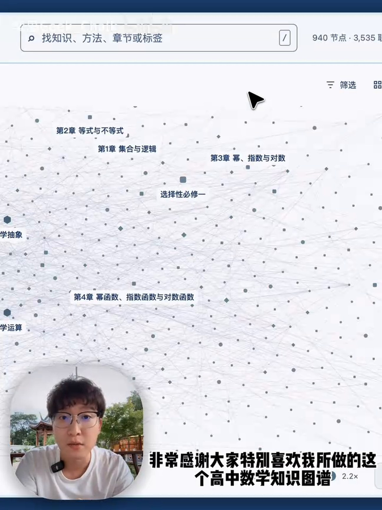

OCR 可见：`找知识、方法、章节或标签` ｜ `第1章集合与逻辑` `第2章等式与不等式` `第3章幂、指数与对数` `第4章幂函数、指数函数与对数函数` ｜ `940节点．3，535耳`（= 940 节点 · 3,535 联系）｜ `三筛选` ｜ `选择性必修一` ｜ `学抽象`（= 数学抽象）

解读：

- 首屏就是**图 + 搜索 + 册/章列表**，没有 dashboard、没有推荐、没有进度条——**它不假设用户有"学习任务"，假设用户有"查找任务"**。
- 搜索框提示语是 `找知识、方法、章节或标签`——**四类实体一个搜索框**，说明底层实体表可统一检索。我们现在的 `searchGo`（`runtime/web/js/views/map.js:1027`）只在**当前渲染的这张图**里按节点 `title` 做 `indexOf`（去空白后），命中后回车逐个定位；没有别名、没有结果列表、不跨实体（§9.2）。

### 3.2 三栏工作台与三筛选区（t = 64 s）

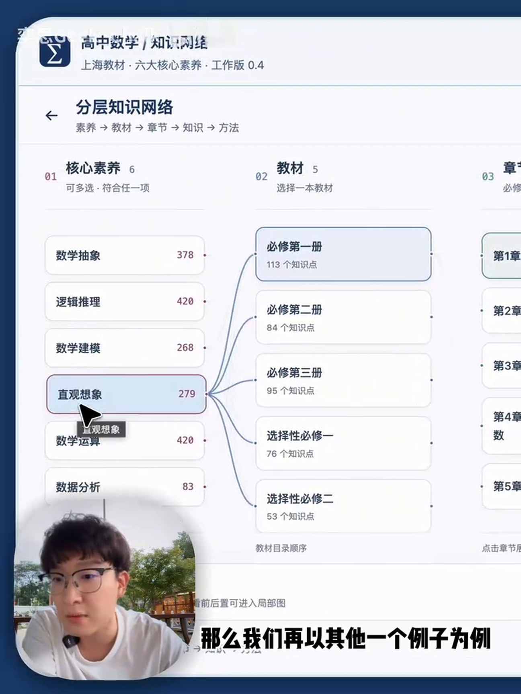

OCR 可见：`上海教材·六大核心素养．工作版0．4` ｜ `分层知识网络` ｜ 页签 `素养 教材 章节 知识 方法` ｜ `核心素养 6 ... 可多选·符合任一项` ｜ `数学抽象 逻辑推理 数学建模 直观想象 ... 数据分析` + 计数 `378 420 268 279 420 0` ｜ `教材 5 ... 选择一本教材` + `必修第一册 113个知识点 / 必修第二册 84 / 必修第三册 95 / 选择性必修一 76 / 选择性必修二 53` ｜ `教材目录顺序 ... 点击章节` ｜ `前后置可进入局部图`

解读：

- 三个筛选区带序号 01/02/03，是有意引导的**漏斗**：先按素养（能力维度）→ 再按教材（位置）→ 再按章节（粒度）。
- 素养计数 378/420/268/279 说明**一个知识点可挂多个素养**（计数总和远超 421 个知识点），这是多对多标签，不是单选分类。

### 3.3 章节树与章内查找（t = 52 s）

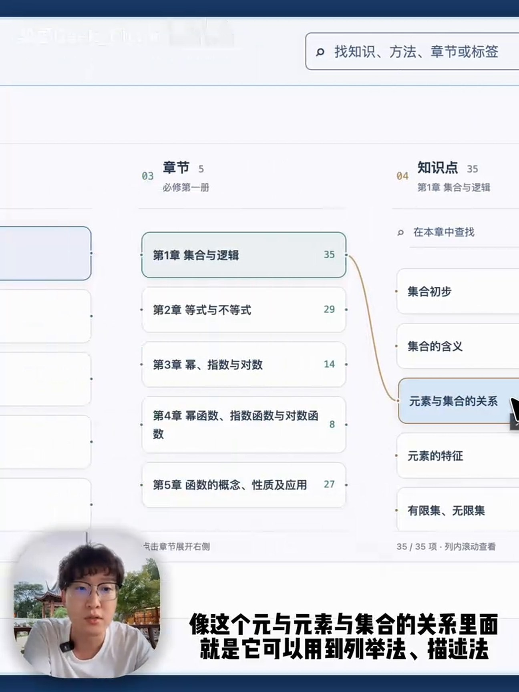

OCR 可见：`必修第一册` `第1章集合与逻辑` `第2章等式与不等式` `第3章幂、指数与对数` `第4章幂函数、指数函数与对数函` `第5章函数的概念、性质及应用` ｜ `点击韋节展开右侧`（= 点击章节展开右侧）｜ 章旁计数 `35 29 14 8 27` ｜ `在本章中查找` ｜ `35/35项．列内滚动責看`（= 35/35 项·列内滚动查看）｜ 知识点列 `集合初步 / 集合的含义 / 元素与集合的关系 / 元素的特征 / 有限集、无限集`

解读：

- **章旁直接标点数**（35/29/14/8/27），"哪章重"一眼可见。合计 113 = 册计数，两处自洽。
- 「在本章中查找」是**作用域内搜索**——大图之外给二级检索，避免全局搜索噪音。我们已经有作用域的**视图**（`map.js` 的 `vol/ch` 选择 + `depth: sec | nb | all`），但缺作用域的**检索框与结果列表**，这是最便宜的补法。

### 3.4 方法节点度数 + 边图例（t = 36 s）


OCR 可见：`解题方法 9`（本章 9 个解题方法）｜ `列举法 2个知识点联系` `描述法 4个知识点联系` `反证法 3个知识点联系` `二分法 1个知识点联系` `数学归纳法 2个知识点联系` ｜ **`实线：解题可用，虚线：使用知识`**

解读：

- 度数直接印在节点旁（2/4/3/1/2），**让人一眼判断"这方法是不是万金油"**。
- 虚实线两义是整个产品最应该抄走的一条设计（§2.4）。多数知识图谱把所有关系压成一条"相关"，导致查询无法回答"这个知识点该用什么方法"。

### 3.5 方法详情与边界声明（t = 80 s）

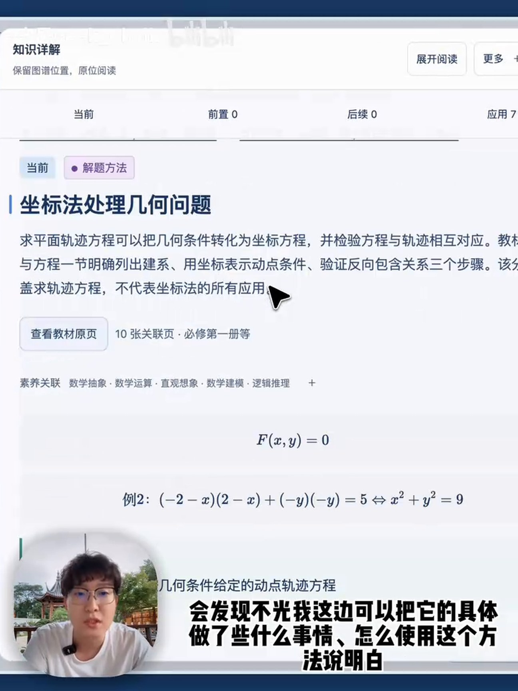

OCR 可见：`后续0` `更多` `应用7` `前置0` ｜ `《坐标法处理几何问题` ｜ `知识详解` `展开阅读` `保留图诣位置，原位阅读`（= 图谱位置）｜ `当前·解题方法` ｜ 描述原文「求平面轨迹方程可以把几何条件转化为坐标方程，并检验方程与轨迹相互对应。教本（= 教材）与方程一节明确列出建系、用坐标表示动点条件、验证反向包含关系三个步骤。该彡（= 该描述）盖（= 覆盖）求轨迹方程，**不代表坐标法的所有应用**」｜ `查看教材原页《10张关联页·必修第一册等》` ｜ `素养关联 数学抽象·数学运算·直观想象·数学建模·逻辑推理`

解读（本文最重要的一屏）：

- 「前置 0 · 后续 0 · 应用 7」三种计数分开：**方法的图谱位置（前置/后续）** 与 **方法的应用面（应用几条知识点）** 是两回事。
- 边界声明是**自然语言写进数据**的，不是 UI 文案。它承认条目覆盖不全，并指出覆盖范围。AI 自动抽取最典型的失败就是**以偏概全**，这一句是解药。
- 「10 张关联页」说明方法也反指教材原页，且是多页。

### 3.6 同一方法的教材位置多值（t = 88 s）

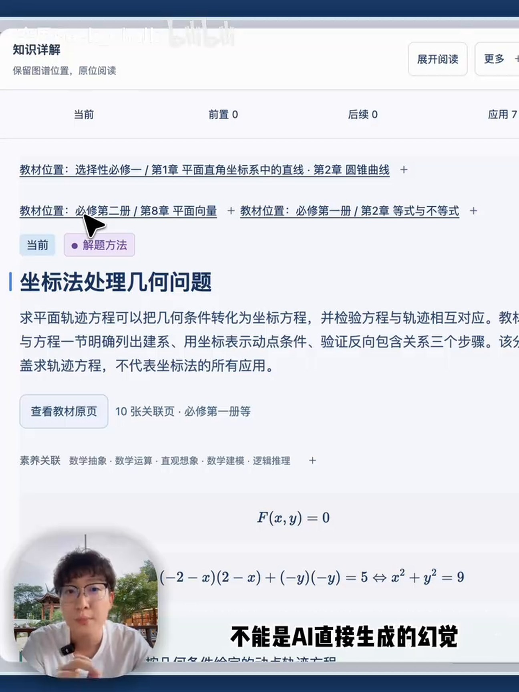

OCR 可见：`教材位置：选择性必修一/第1章平面直角坐标系中的直线．第2章圆锥曲线` ｜ `教材位置：必修第二册／第8章平面向量` ｜ `教材位置：必修第一册／第2章等式与不等式` ｜ 另有口播字幕 `不能是A（= AI）直接生成的幻觉`

解读：

- **一个方法散落在三册五章**，位置字段必须是数组，且每条要带「册 + 章（+ 节）」。
- 这三处正是"坐标法"在不同学段的多次出现（一次函数坐标几何／直线与圆锥曲线／向量坐标运算），**是多值位置的真实理由，不是数据冗余**。
- 字幕「不能是 AI 直接生成的幻觉」是作者的产品宣言。

### 3.7 教材原页阅读器（t = 108 s）

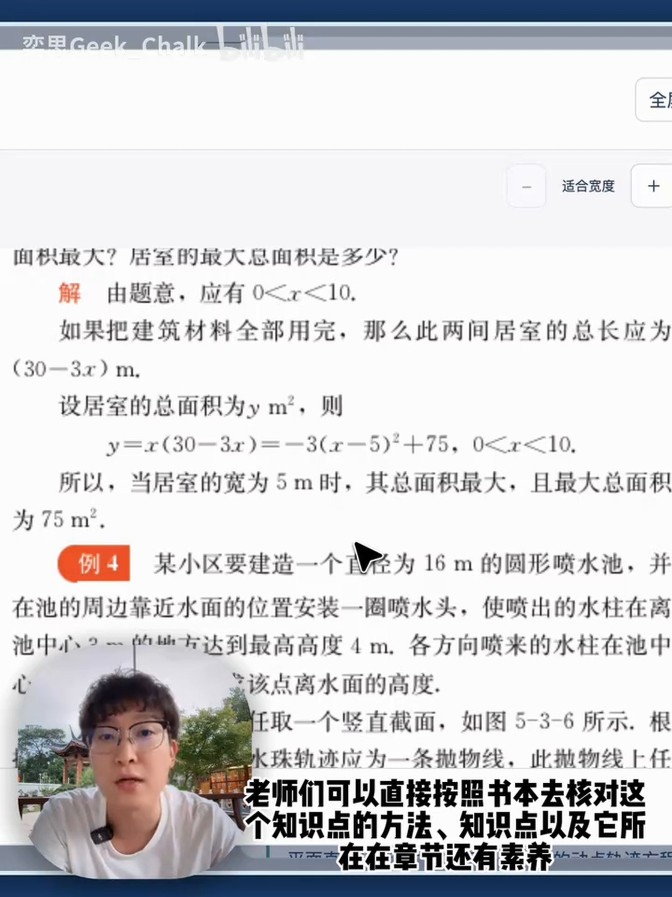

OCR 可见：`适合宽度` ｜ 原题 5-3-5：`如果把建筑材料全部用完，那么此两间居室的总长应为（30−3x）m` `设居室的总面积为…则 y=…=−3(x−5)²+75，0<x<10` `所以，当居室的宽为5m时，其总面积最大，且最大总面积为75m²` ｜ 原题 5-3-6：`某小区要建造一个半径为16m的圆形喷水池…达到最高高度…如图5-3-6…轨迹应为一条抛物线`

解读：

- **这是"防幻觉"的最终仲裁层**：任何条目一键回到同一页同一图。
- 技术上就是 PDF 页面渲染 + 页码定位，不需要 OCR 结构化——**我们已有的教材 PDF（北京版八上 169 页有文字层）完全能复刻这一屏**，成本极低，收益极高。

### 3.8 局部图：前置准备 / 当前知识 / 后续知识（t = 180 s）

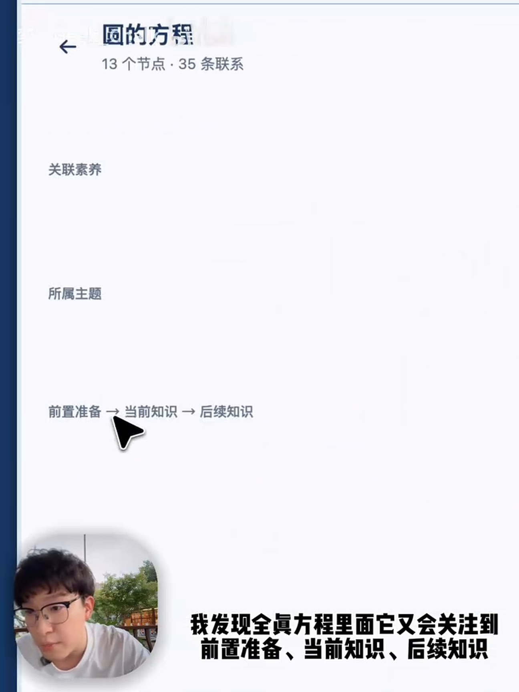

OCR 可见：`圆的方程` ｜ `13个节点·35条联系` ｜ `关联素养` ｜ `所属主题` ｜ `前置准备 当前知识 后续知识`

解读：

- 局部图是三段式（前置/当前/后续），**不是"邻居一圈"**。这是教学视角：老师关心的是"上这节课之前学生该会什么、这节课之后通向哪里"。
- 「所属主题」侧栏把节点挂回更大的教学主题（对应 §7.1 的「教学主题」框架）。

---

## 4. 制作手记图集（11 张）

### 4.1 循环核对总图（t = 5 s）

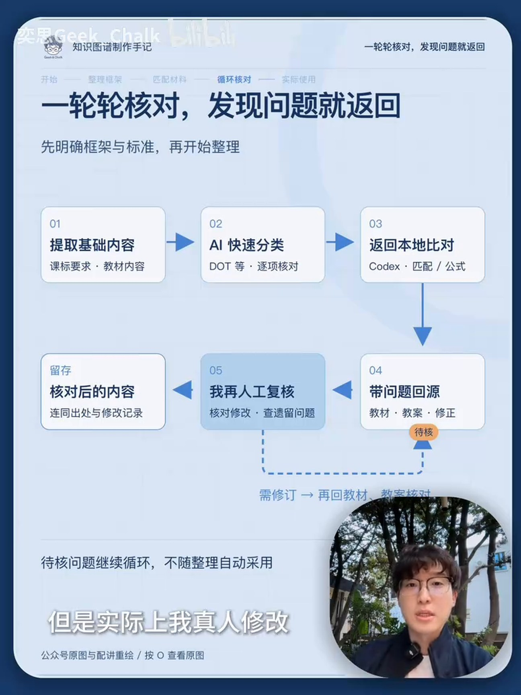

OCR 可见：`知识图谐制作手记`（= 知识图谱制作手记）｜ `循环核对` ｜ `一轮轮核对，发现问题就返回` ｜ `先明确框架与标准，再开始整理` ｜ 五步：`01 提取基础内容（课标要求·教材内容）` `02 AI快速分类（DOT等·逐项核对）` `03 返回本地比对（Codex·匹配/公式）` `04 题（= 带问题）回源（教材·教案·修正）` `05 再人工复核（核对修改·查遗留问题）` ｜ `留存：核对后的内容，连同出处与修改记录` ｜ **`待核问题继续循环，不随整理自动采用`**

解读：五步不是流水线，是**闭环**——02 的 AI 分类结果必须过 03 本地比对、04 回源、05 人工复核，未解决就回到 01/02 重来。口号是「发现问题就返回」。

### 4.2 「先有一份自己的框架」（t = 40 s）

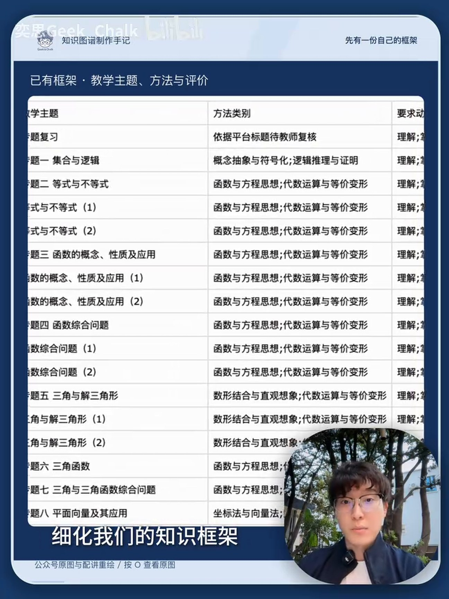

OCR 可见：`已有框架·教学主题、方法与评价` ｜ 教学主题列：`题一集合与逻辑` `题二等式与不等式（1）（2）` `题三函数的概念、性质及应用（1）（2）` `题四函数综合问题（1）（2）` `题五三角与解三角形（1）（2）` `题六三角函数` `题七三角与三角函数综合问题` `题八平面向量及其应用` ｜ 方法类别列反复出现：`概念抽象与符号化；逻辑推理与证明` `函数与方程思想；代数运算与等价变形` `数形结合与直观想象；坐标法与向量法` ｜ 边注 **`依据平台标题待教师复核`**

解读：

- **框架是教师自己的教学主题（题一…题八），不是教材章名**。这是全片最重要的方法论：先有"我怎么教"的框架，再让 AI 往里填，而不是让 AI 从教材里抽框架。
- 边注「依据平台标题待教师复核」说明**连框架的标题都标着待核状态**——状态标记渗透到最上层。

### 4.3 评价标准与要求动词（t = 45 s）

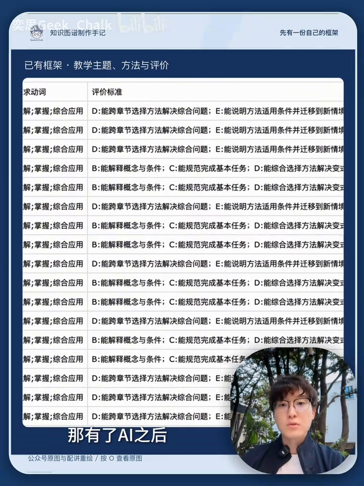

OCR 可见：`要求动词`：`了解／理解／掌握／综合应用`（另有 `经历、体会、感悟、抽象、建模、判断、推导、证明、运用、解决、选择`）｜ `评价标准`：`B：能解释概念与条件；C：能规范完成基本任务；D：能综合选择方法解决变式；D：能跨章节选择方法解决综合问题；E：能说明方法适用条件并迁移到新情境`
（OCR 里出现两个 `D`，疑为 A–E 五级中 **B 之前还有 A**，未取到，标【疑】）

解读：

- 评价标准是**行为化描述**，每级都以「能…」开头，且逐级升维（解释概念 → 完成基本任务 → 选方法解变式 → 跨章节选方法 → 说明适用条件并迁移）。这与我们已有的六维难度（K/R/C/I/P/V）思路不同：它是**能力层级**，我们是**题目属性**，两者可并存但不要混。
- 动词不是标签而是**可统计证据**（§7.2）。

### 4.4 「查阅材料·对应到已有框架」（t = 70 s）


OCR 可见：`查阅材料·对应到已有框架` ｜ `Codex` ｜ `课理标准`（= 课程标准）｜ `豆包` ｜ **`把要求，放回具体材料里`**

解读：

- 工具是 Codex + 豆包双开：一个在本地跑（能读文件、能算），一个做快速分类。口播里明确为"三段分工"（§7.4）。
- 「把要求放回具体材料里」是全片的操作口号：抽象的要求（理解/掌握）必须落到具体条目、具体页码、具体例题。

### 4.5 知识条目 + 教材位置 + 原页（t = 95 s）

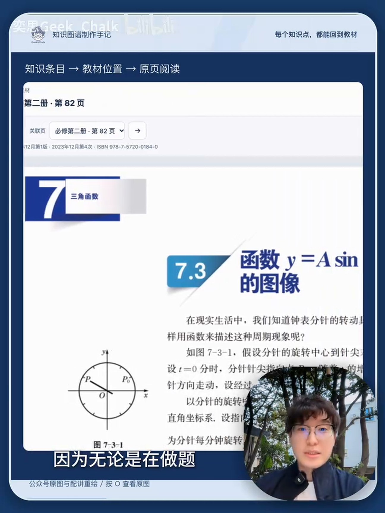

OCR 可见：`知识条目 教材位置 原页阅读` ｜ `第二册．第82页` ｜ `关联页 必修第二册．第82页…` ｜ `…12月第1版·2023年12月第…ISBN978-7-5720-01-0…` ｜ `三角函数` ｜ `7-3` ｜ `每个知识点，都能回到教材` ｜ `图7-3-1` ｜ 原页文字 `在现实生活中，我们知道钟表分针的转动…怎样用函数来描述这种周期现象呢？…如图7-3-1，假设分针的旋转中心到针尖…`

解读：

- 三栏「知识条目 / 教材位置 / 原页阅读」就是 §2.7 那一屏的结构。
- **版次 + ISBN + 页码 + 图号**四件套齐全。这一点对我们特别重要：北京版有 2024 新版与 2025 秋社学版（扫描版无文字层），**不写版次就无法回溯**。

### 4.6 类比：同一思想连到不同对象（t = 165 s）

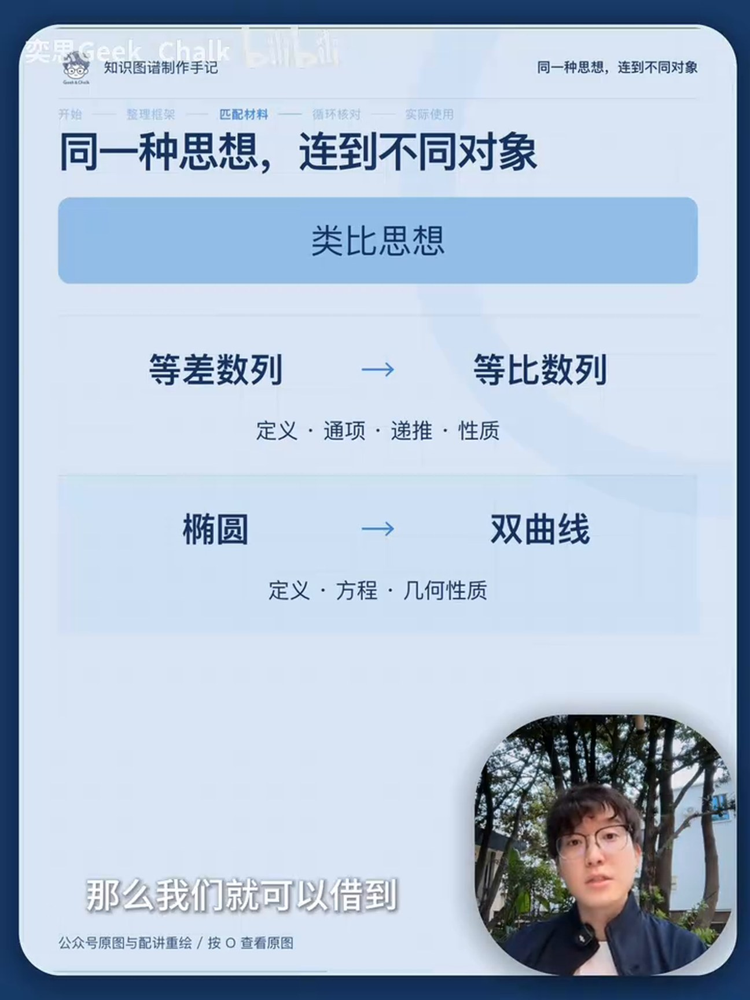

OCR 可见：`匹配材料` ｜ `同一种思想，连到不同对象` ｜ `类比思想` ｜ `等差数列 ↔ 等比数列：定义·通项·递推·性质` ｜ `椭圆 ↔ 双曲线：定义·方程·几何性质`

解读：

- 这是一种**跨章边**：不是"前置/后续"，而是"可类比"。它回答老师最常问的"这个能不能类比着讲"。
- 口播补充了操作要求：「借鉴研究过程；**结论重新推导、检验**」——类比边不能替代证明。

### 4.7 循环核对五步全亮 + 留存（t = 245 s）

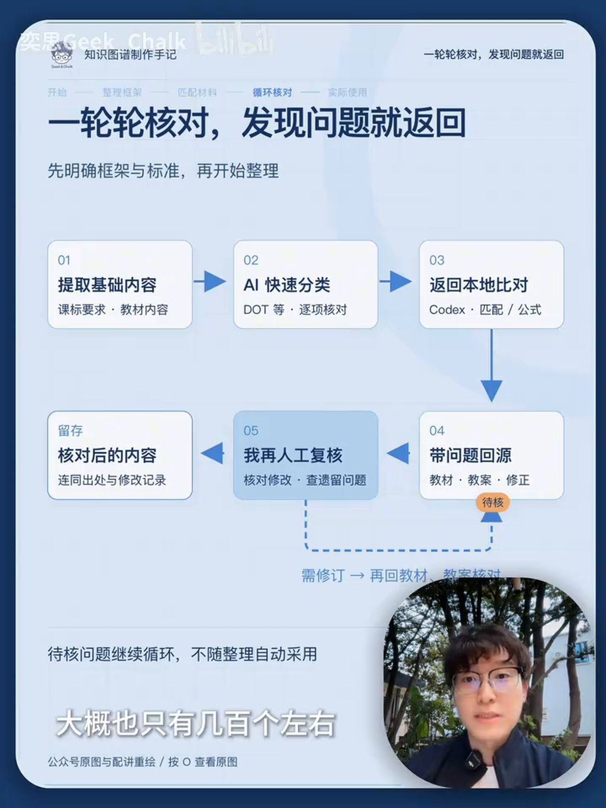

OCR 可见：与 4.1 同构，但 `05 我再人工复核`、`留存 核对后的内容 连同出处与修改记录` 两处高亮；`待核 需修订再回教材`

解读：

- **留存 = 内容 + 出处 + 修改记录**，三件一起存。这是把"可评审性"写进数据模型（对应我们在 math-coach spec 里定的「权威 = Git 文本 JSONL」，天然满足）。

### 4.8 AI 反问：条目身份该怎样收录（t = 255 s）

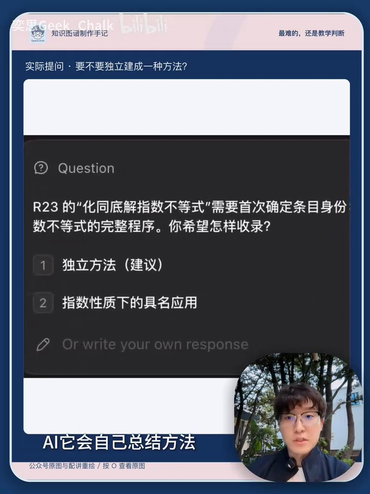

OCR 可见：`实际提问·要不要独立建成一种方法？` ｜ `最难的，还是教学判断` ｜ 弹窗原文：「`R23 的"化同底解指数不等式"需要首次确定条目身份`…`数不等式的完整程序。你希望怎样收录？`」｜ 两个选项：`1 独立方法（建议）` `2 指数性质下的具名应用` ｜ `write your own response`

解读（**这是可复制性最高的一段**）：

- AI 不是自己拍板，而是**把判断显式抛回给人**，并且给出"建议 + 备选 + 自定义"三种出口。
- 判断的轴是「**条目身份**」：这个东西是一个独立方法，还是某性质下的一个用法？这个决定会传染整张图（如果建成独立方法，它就有了自己的前置/后续/素养/教材位置）。
- 可复制的机制：**凡是"这条要不要单独建节点"的判断，不要静默决定，用弹窗问人，并把答案记进数据**。我们的出题/入库管线完全可以照这个做（例如「这道题的解法要不要新登记为一个方法族」）。

### 4.9 一个过程既有方法也有思想（t = 305 s）

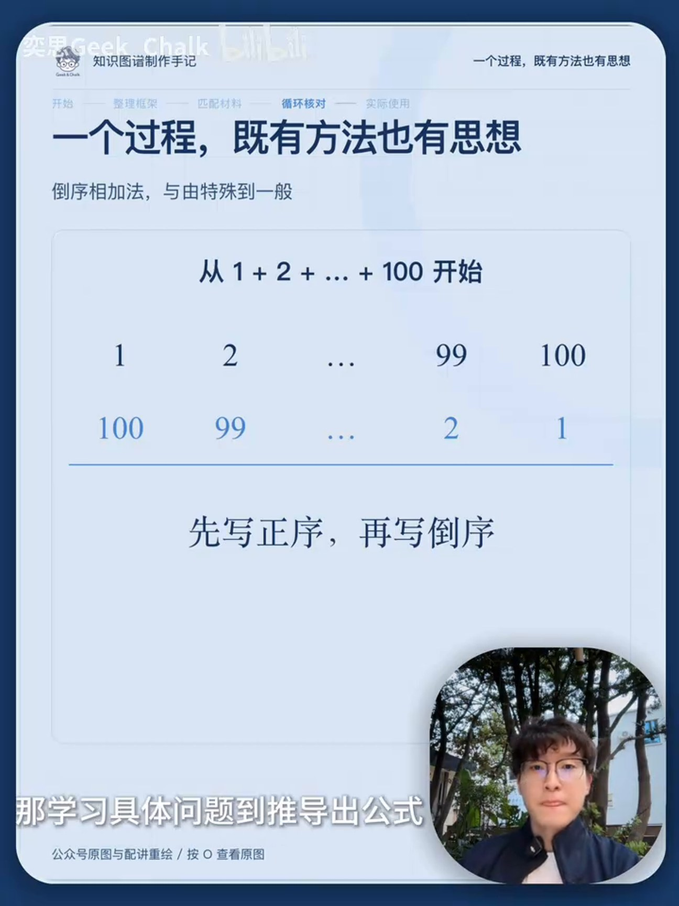

OCR 可见：`一个过程，既有方法也有思想` ｜ `倒序相加法，与由特殊到一般` ｜ `从1+2+…+100开始` ｜ `先写正序，再写倒序` ｜ 后续帧（f0062/f0063）出现 `1 100 2 99 101`、`对应相加，每一组都是101`

解读：

- **同一段推导要打两层标注**：
  - **方法层**（怎么操作）：正序 + 倒序 → 对应相加 → 每对 101 → 2S = 100×101 → S = 5050；
  - **思想层**（怎么想到的）：由特殊到一般（推广到等差数列求和）。
- 这条直接对应我们已有的「双轴分类」：J-GEO（知识轴）+ M-SYN/MET/ANA/INV/EXT/COM（方法轴，6 族 25 法 97 技法）。**差别在于它是"一个过程两层标注"，我们是"一个对象归一类"**——它允许同一节点同时是方法与思想，我们的 schema 目前要求二选一。

### 4.10 逐处检查数学显示（t = 360 s）


OCR 可见：`实际使用` ｜ `放进平台，还要实际读一遍` ｜ `我也借助 Claude，继续调整前端` ｜ `逐处检查数学显示` ｜ `分式：分子与分母` `根号：覆盖的范围` `上下标：位置与含义` ｜ `正文·步骤·标题·弹窗` ｜ **`界面读得顺，数学意思也要对`** ｜ `检查与修订` `返回再读`

解读：

- 检查项是**三类结构 × 四个位置**的矩阵：分式（分子/分母归属）、根号（覆盖范围）、上下标（位置与含义），逐个在 正文/步骤/标题/弹窗 四处看一遍。
- 这与我们实测的痛点完全同构：ch10 教材题因**分式分子里混进等式/乘除号**被迫剔除 4 道（\frac{2×3=9/2} 之类），根号在 PDF 里是矢量图形导致 11 章 56 题 root_lost。**这一屏等于把我们的 bug 清单提前了一年。**

### 4.11 收尾：磨刀不误砍柴工（t = 405 s）

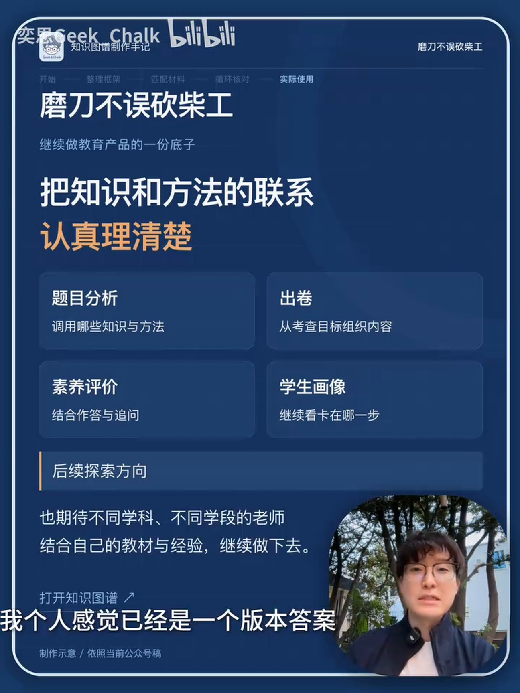

OCR 可见：`磨刀不误砍柴工` ｜ `继续做教育产品的一份底子` ｜ `把知识和方法的联系认真理清楚` ｜ 后续探索方向：`题目分析：调用哪些知识与方法` `素养评价：结合作答与追问` `学生画像：继续看卡在哪一步` `出卷：从考查目标组织内容` ｜ `也期待不同学科、不同学段的老师，结合自己的教材与经验，继续做下去` ｜ 字幕 `个人感觉已经是一个版本答案`

解读：

- 四个下游应用全部依赖图谱，且**每个都指明了需要图谱提供什么**：题目分析要"调用哪些知识与方法"（题→知识/方法边）、素养评价要"结合作答与追问"、学生画像要"卡在哪一步"（步骤级，不是题级）、出卷要"从考查目标组织内容"（目标→内容反向边）。
- **这正是 math-coach 缺的东西**：我们有题、有诊断，但缺"题 → 知识/方法"这条边，所以诊断只能给出"这个知识点薄弱"，给不出"你在哪一步、用了错的哪个方法"。

---

## 5. 制作流程：五步闭环

### 5.1 五步与各自的人机分工

| 步 | 名称 | 做什么 | 谁做 | 产出 |
| --- | --- | --- | --- | --- |
| 01 | 提取基础内容 | 从**课标要求**与**教材内容**取条目 | 人定范围，AI 抽取 | 原始条目池 |
| 02 | AI 快速分类 | 「DOT 等」工具批量分类，**逐项核对** | AI 主做，人逐条看 | 带归属的候选 |
| 03 | 返回本地比对 | **Codex 在本地**比对匹配、验算公式 | AI 本地执行 | 冲突/可疑清单 |
| 04 | 带问题回源 | 拿着问题回**教材·教案**修正 | 人做 | 修正稿 |
| 05 | 再人工复核 | 核对修改、查遗留问题 | 人做 | 可用条目 |
| — | 留存 | 内容 + **出处** + **修改记录** | 系统 | 可回溯资产 |

三条过程规则（都是画面上写着的原话）：

1. **「先明确框架与标准，再开始整理」**——01 之前必须已有框架（§4.2）与评价标准（§4.3），否则整理没有归处。
2. **「一轮轮核对，发现问题就返回」**——不是一次过，是返回式循环。
3. **「待核问题继续循环，不随整理自动采用」**——**未解决的问题不许因为"整理完了"就默认通过**。这是整条流程最硬的一条纪律。

### 5.2 为什么第 03 步要「返回本地」

视频里两次强调工具分工：Codex 在**本地**跑（能读文件、能执行算公式），豆包做**快速分类**（§4.4）。理由是：AI 的"分类"可以错，但"公式对不对、页码对不对"这种能算能查的事，必须回到本地与原始材料上验一遍，而不是让模型自己说"我核对过了"。

对应到我们的工程现实：这一点我们已经做到了（`tools/check_all.sh` 九步闸门：字段契约 → 题库校验 → 评分点 → 数学式真渲染 → 判题回归 → 一致性 → 框架报告 → 前端切片 → 冒烟）。**我们缺的不是"本地核对"这一步，而是"人工复核状态机"这一层**——现在数据没有 `reviewed_by` / `reviewed_at` / `needs_review` 这类字段，无法表达"这条核过了、那条还是候选"。

### 5.3 时间与规模

- 一个月，纯人工，含核对、标注、修改、取舍；
- 「没办法做 SOP，因为它过于复杂，而且是一个基于人的教学活动」；
- 自我描述：「我就像一个数字民工一样，不断地去核对、标注修改、取舍」。

**结论**：这条路的产能上限极低。我们要么接受低覆盖率，要么用"抽样复核 + 状态标注"替代全量人工（§10）。

---

## 6. 教学判断：最难的一步（本片最有价值的部分）

### 6.1 两种失败模式

原话级的两句话（§4.2 附近的字幕）：

- **拆得太细**：同一性质的用法变成一串名字，一个东西拆成几块；
- **合得太粗**：条件、步骤不同的解法混在一起。

这两句几乎是所有知识图谱项目的死因：拆细则图爆炸且无教学意义，合粗则查询无区分度。

### 6.2 四条判据 → 三层收录

面对"这个条目算不算独立方法"，判据是四条【实】：

1. **共同步骤**——它有没有自己稳定的操作步骤？
2. **适用条件**——它有没有明确适用的题型/条件？
3. **学生已有知识**——学生是否已经具备理解它所需的前置？
4. **是否为跨章节思想**——它是本章技巧，还是跨章通用的思想？

据此分三层收录：

| 层 | 什么时候用 | 例 |
| --- | --- | --- |
| 知识点下的**用法** | 只是某性质的具体应用，没有独立步骤 | 「指数性质下的具名应用」 |
| **独立方法** | 有共同步骤 + 适用条件 | 「化同底解指数不等式」（Codex 建议此项） |
| **跨章节思想** | 跨章通用 | 「由特殊到一般」「化归与转化」 |

### 6.3 同一过程，两层标注

倒序相加（§4.9）是标准示范：

- **方法层**标"怎么操作"：正序与倒序 → 对应相加 → 每对 101 → 2S = 100×101 → S = 5050；
- **思想层**标"怎么想到的"：由特殊到一般（推广到一般等差数列）。

**一个过程同时挂两条边，不是二选一。** 我们的双轴分类（J-GEO / M-*）目前是"一个对象归一类"，这会导致：倒序相加要么登记成方法（丢掉思想层），要么登记成思想（丢掉可操作步骤）。

### 6.4 教材顺序 ≠ 实际依赖

原话：「**先讲后学的顺序，还要与实际依赖分清**」【实】。

操作定义：

- 判断实际依赖的方法：**先看这个概念、这个推导、这个解法用了什么**；
- 然后回到材料核对（题目、解答、原文）；
- 再解释前后联系（结合教材顺序与学习过程）。

于是至少有三种边并存：

| 边 | 含义 | 判定依据 |
| --- | --- | --- |
| 教材顺序 | 书上先讲后讲 | 目录 |
| 学习依赖 | 学 B 之前必须会 A | 概念/推导的实际使用 |
| 解题可用 | 方法 M 能解知识点 K 的题 | 例题与解答 |

我们现在的先修边（479 条：人工 342 + 规则 137；章级 45、知识点级 183 覆盖 26.2%）只表达了"学习依赖"，**没有教材顺序边，也没有解题可用边，更没有类比分**。

### 6.5 AI 反问机制（可复制的工程做法）

§4.8 那个弹窗值得当作一个**模式**抄下来：

```
问题：R23 的「化同底解指数不等式」需要首次确定条目身份
      原材料已给出：统一底数 / 按底数范围判断单调方向 / 解指数不等式的完整程序
      你希望怎样收录？
  [1] 独立方法（建议）
  [2] 指数性质下的具名应用
  [ ] 自己写一条
```

三个特征：

1. **AI 给建议但不代决**；
2. **选项是"结构选择"而不是"内容选择"**（选的是节点身份，不是措辞）；
3. **答案回写进数据**（身份一旦定，后续所有边都按这个身份建）。

对我们最直接的移植点：出题/入库管线里凡是遇到"这算新方法族还是已有方法族的变式"、"这题该挂到哪个知识点"这类结构判断，都用"弹窗 + 建议 + 备选"的形式问人，并把结论记成数据（`identity_decision` 之类），而不是让校验脚本静默归类。

### 6.6 方法自己也有前置/后续

§2.6 已述：方法之间成图。这一点很多图谱没做，导致"方法"只是标签。它的做法是让方法节点也带 `前置 / 后续 / 应用` 三种计数（画面：前置 0 · 后续 0 · 应用 7），并且前后置可点进局部图。

---

## 7. 材料与来源策略

### 7.1 教案是第一来源（不是课标）

口播最重要的一条判断：「**我把教案作为最主要的一个来源，就是因为教案是老师会实际带课堂、帮助教学的工具**」。

理由（口播整理）：

- 教材往往**不写明方法**（方法隐含在例题里），但教案会写明思维、素养、引导语、前后类比；
- 教案能看出"某个思维方法在不同知识点中的实际应用"（例如类比：等差→等比、椭圆→双曲线）；
- 课标给的是**要求**（了解/理解/掌握），教案给的是**做法**。

材料三源排序（视频结构）：**课标·教参（要求）→ 课本·教学设计（内容）→ 教案（做法）**。

对我们的现实意义：我们手上有的正是"教材 + 真卷 + 教辅 docx"，**没有教案**。这意味着我们能拿到"要求"和"内容"，拿不到"做法"——所以方法层只能靠"从例题与答案反推 + 人工判断"，成本更高，且必须标 `draft`。

### 7.2 要求动词是可统计的证据

画面里有动词频次表（OCR 可读部分，见 §11 附录 B），例如：

```
能：88   会：30   理解：29   抽象：25   分析：18   判断：14   建模：14   运…
证明：45  会：35   判断：33   能：31   理解：28   抽象：27   分析：14   …
```

用法：**用动词频次反推某个主题/章节的要求强度**——「能」多说明偏操作，「理解」多说明偏概念，「证明」多说明偏推理。这比人工贴"难/易"标签更客观，且可复算。

### 7.3 教材定位的四件套

每个知识点/方法都要能定位到：**册 + 章（+ 节）+ 页码 + 图号/题号**，并附 **版次 + ISBN**（§4.5 画面：2023 年 12 月第 1 版、ISBN 978-7-5720-01…、第二册第 82 页、图 7-3-1）。

我们这边的对照现实：北京版八上有 2024 新版（169 页，**有文字层**）与 2025 秋社学版（145 页，**无文字层**）。**不写版次就无法回溯**，这条我们必须补。

### 7.4 AI 三段分工（口播）

1. 第一轮：按课标梳知识点框架 + 从教材取内容；
2. 第二轮：AI 快速分类丢进框架 → 再把返回内容与已有内容**对比**、检查匹配与归属（二次校验）；
3. 最后：人工复核学科性表述。

并且明确承认风险：「很多时候它给的建议我们并不能直接采纳，要判断这些组织是否符合教学、是否真是课本上的东西，**还是 AI 在总结过程中自造的教学结论或知识点结论**」。

---

## 8. 技术实现推断

### 8.1 有证据的（【实】/【推】）

| 项 | 判断 | 依据 |
| --- | --- | --- |
| 形态 | 单页 Web 应用，三栏 + 页签 + 弹层 | 界面结构 |
| 图渲染 | 力导向/分层图，节点带标签与度数 | 全局图与局部图观感、节点旁的"2 个知识点联系" |
| 数据规模 | 千级节点、数千级边，前端直接渲染 | 940/3535 |
| 检索 | 单一搜索框覆盖知识/方法/章节/标签四类 | 搜索框提示语 |
| 教材原页 | PDF 页渲染 + 页码跳转 | 阅读器一屏 |
| 关系模型 | 至少 3 类边（教材顺序 / 使用知识 / 解题可用）+ 类比分 | 图例与教学主题页 |
| 实体 | 知识点、方法、章节、教材、素养、标签、教学主题（≥7 类） | 五页签 + 加"标签""所属主题" |
| 状态 | 条目带"待核/待教师复核"状态 | 边注 |

### 8.2 合理推断（【推】）

- 数据大概是**若干 JSON/表格**（知识点表、方法表、位置表、边表、素养映射表），前端加载后构图——因为如果是数据库驱动，局部图与全局图的切换会有明显加载态；画面里切换很轻。
- 「关联页 10 张」说明存在 **node → page 的多对多表**（一个知识点对应教材多页）。
- 素养计数（378/420/…）说明素养是**预计算好的聚合**，不是实时算的。
- 「工作版 0.4」+ 无登录 + 无账号体系 → 静态部署（很可能 Cloudflare Pages / Vercel 一类）。

### 8.3 未知（不要猜）

- 后端与存储（很可能没有后端）；
- 构建管线（是否有脚本把教材 PDF/教案转成条目）；
- 审核流是否有工具支撑（大概率是人工 + 笔记，**没有专门的审核后台**，否则不会说"没办法做 SOP"）；
- 是否会将代码或数据开源（作者 GitHub 无相关仓库）；
- 940 与 421 的口径差从何而来。

---

## 9. 与 math-coach 的差距

### 9.1 我们现状（一句话）

math-coach 现在是（据 `docs/framework-status.md` 与 README，2026-10-27）：**北京版初中六册框架 26 章 / 143 节 / 673 个知识点**（全部 `draft`；只有 801 八年级上册的版次标「已核」，其余五册「待核」；701 仍 `section_title_only`）**+ 2708 道题**（第 12 章 1242、第 11 章 614、第 10 章 482、第 13 章 370；八上 27 节全覆盖、另 4 份章末卷 513 题；其余五册 116 节零题）**+ 先修边 479 条 + 自动判 427/2642 题 + 判题回归 54 条 + 九步本地闸门 + 前端切片**。

### 9.2 差距矩阵

| 维度 | 它 | 我们 | 差距性质 |
| --- | --- | --- | --- |
| 层数 | 5 层（素养/教材/章节/知识/方法）+ 教学主题 | 3 层（章/节/知识点）+ 方法码 | **结构性** |
| 方法地位 | 一等公民：独立页、前置/后续、应用数、边界声明 | 标签（M-* 码），无页面、无边界、无前后置 | **结构性** |
| 边语义 | 3 类（教材顺序 / 使用知识 / 解题可用）+ 类比分 | 1 类（先修，479 条：人工 342 + 规则 137），无教材顺序边、无解题可用边、无类比分 | **结构性** |
| 教材定位 | 册+章+节+页码+图号，多值，带版次 ISBN | 册/章/节三级齐（26 章 143 节），**但无页码、无图号、无原页**；仅 801 版次「已核」，五册「待核」 | **数据** |
| 教材原页 | PDF 阅读器可跳页 | 有 PDF（八上 169 页有文字层），前端无阅读器 | **工程量小，收益大** |
| 素养层 | 6 素养多对多 + 计数 | 无 | **缺失** |
| 局部图 | 前置准备 / 当前知识 / 后续知识 三段 + 关联素养 + 所属主题 | 有依赖图，但无教学分区、无素养侧栏 | **中** |
| 审核状态 | 待核标记渗透到标题层，留存出处+修改记录 | 有 `ai_draft`、有「已核/待核」版次标注，但**无条目级状态机**（`needs_review`/`reviewed`）、无 `reviewed_by/at`、无修改记录 | **结构性** |
| 规模 | 421 知识点 / 940 节点 / 3535 边 / 1 个月人工 | 673 知识点 / 143 节 / 479 先修边 / 2708 题 | 知识点数相当；**它的边是我们的 7 倍，且多为人核过；我们的边多为机器派生** |
| 产能方式 | AI 两万候选 → 人核几百 → 图三千 | 机器派生 + 闸门校验，无人工复核环节 | **路线不同** |
| 检索 | 全局四类实体 + 章内作用域检索 + 结果计数 | `searchGo` 只对当前图节点 `title` 做 `indexOf`，无别名、无结果列表、不跨方法/章节/标签 | **必须修** |
| 题-知识-方法边 | 下游应用的前提（题目分析要"调用哪些知识与方法"） | 题只挂单个知识点，无方法标注 | **结构性缺失** |

### 9.3 可以直接借的 8 条（按性价比排序）

1. **教材原页阅读器**（1 天）：PDF 页渲染 + `page` 字段跳转。我们八上 PDF 有文字层，直接能做；这是防幻觉的最便宜手段。
2. **边语义分层**（0.5 天）：把 `dependencies` 拆成 `order`（教材顺序）/ `requires`（学习依赖）/ `solves`（解题可用）三类，前端图例区分虚实线。
3. **方法节点升级**（2–3 天）：方法从标签变成节点，加 `detail` / `bound_statement`（边界声明）/ `steps` / `pre` / `post` / `applies_to` 字段。
4. **章内作用域检索**（0.5 天）：给 `searchGo` 加别名表 + 命中列表（现在只能回车逐个跳），并在章视图加「在本章中查找」。同名不同义的高频词（圆/对角/方差/集合）必须靠别名与作用域分开。
5. **边界声明字段**（0.5 天，与 3 同做）：所有方法条目必须有"不覆盖什么"。
6. **局部图三分区**（1–2 天）：前置准备 / 当前知识 / 后续知识，替代"邻居一圈"。
7. **审核状态机**（1 天）：`status ∈ {draft, needs_review, reviewed}` + `source`（册/章/页/版次）+ `reviewed_by/at`，前端显示"待核"角标。
8. **素养多对多标签**（1 天）：六大素养打标 + 计数聚合；我们已有六维难度，素养是另一条正交轴。

### 9.4 不该照搬的 3 条

1. **一个月纯人工全量核对**。我们没有这个人力，且孩子只用北京版初中一册，全量核对的边际收益极低。替代：**抽样复核 + 状态标注 + 只对"孩子实际做错的题所涉条目"做人工确认**。
2. **两万候选 → 几百条人工**的漏斗。我们的 479 条先修边是机器派生 + 少量人工标注的"结构证据"，不需要回到"人挑"模式；需要人工的是**方法层与教材定位**，不是全部边。
3. **以方法为中心重构整个 schema**。它是"图谱先行、诊断跟随"，我们是"题库先行、图谱补位"。照搬会把 2708 道题全部作废重挂。正确做法是**加边、加字段、不迁数据**（见 §10）。

---

## 10. 若要重建：三段路线（对齐现有 milestone）

### 段一 · 低成本高收益（1–2 天，不改数据模型，只加字段与视图）

- [ ] `topics.jsonl` 加 `locations: [{edition, volume, chapter, section, pages[], figure}]`（先只填 801 八上四章 10/11/12/13——唯一「已核」册；其余留空并标 `unlocated`）；
- [ ] 加 `tools/page_reader`（PDF → 指定页 PNG/前端 iframe + `#page=`），知识点详情加「查看教材原页」按钮；
- [ ] `dependencies` 增加 `kind: order | requires | solves`（现有 hard/soft 保留为 `strength`）；
- [ ] 修检索：分词 + 章节作用域 + 别名表（用 `id-aliases` 之外的**术语别名**，如「分式」→「分式有意义/值为零」）。

### 段二 · 结构性（3–5 天）

- [ ] 方法节点表 `methods.jsonl`：`id, name, family(M-*), steps[], bound_statement, pre[], post[], applies_to[], locations[], standards[]`；
- [ ] 素养标签表 + 聚合计数；
- [ ] 局部图三分区（前置准备 / 当前知识 / 后续知识）；
- [ ] 审核状态机（`draft / needs_review / reviewed` + `source` + `reviewed_by/at`），前端角标；
- [ ] 题 → 方法边：每道题的 `answer_steps` 里标注"用到哪个方法"（先做八上 2708 题里的高频方法，第 12 章 1242 题起步，覆盖 80% 即可）。

### 段三 · 重活（数周，按需）

- [ ] 六册教材位置全量校准（需 2024 新版七上/八下/九上/九下目录，本地缺）；
- [ ] 方法前置/后续图（方法之间成图）；
- [ ] 素养评价与"卡在哪一步"（需题级步骤数据 + 判题 L2 分步结果）；
- [ ] 出卷「从考查目标组织内容」（目标 → 知识/方法反向边）。

---

## 11. 手机端复盘（2026-10-27 录屏）

> 信源：`D:\个人\知识图谱\传神20261027-172455.mp4`，10 分 27 秒，540×1172 竖屏，30 fps。
> 采集：`fps=1/5` 抽 157 帧 → 放大 1.8× → WinRT OCR（`ocr.txt` 4247 行）；音频 16 kHz mono → faster-whisper base（`asr.txt` 32 段）。
> 限制：与前两片相同——**我没有视觉能力**，全部描述由 OCR 文本重建；手机竖屏字号更小，OCR 错字率明显高于教师版，凡关键结论都尽量用「多帧互证 + 口播互证」两条腿站稳。

### 11.1 这一片是什么

一条抖音竖屏录屏：从 App 内搜索「kk 可视化高数思维导图」进入同作者的视频，再横过来把产品完整走一遍。口播给的规模口径是「经过一个多月的打磨，从最开始的一个小项目，到今天已经实现了 **6 万+ 的浏览量**」，并自称「在高中数学这个领域，它就是全网最好的知识图谱……**它就是一个范式，所有人都可以照着这个来做**」。

它和教师版是**同一个产品的前后两代**：教师版角标写「工作版 0.4」，这一片里搜索框、图例、详情页三处都改了。所以这份录屏的价值不是「再看一遍功能」，而是**看它迭代时优先动了什么**。

### 11.2 与教师版的八处变化（这是本节的核心）

| # | 维度 | 教师版（工作版 0.4） | 手机版（本片） | 说明它认了什么 |
| --- | --- | --- | --- | --- |
| 1 | 搜索占位符 | 找知识、方法、章节或**标签** | 找知识、**思想**、方法或章节 | 思想被提到检索一级；「标签」退场 |
| 2 | 图例 / 筛选类 | 五层：素养 / 教材 / 章节 / 知识 / 方法 | 七类：核心素养 / 章节 / **知识主干** / 知识点 / 解题方法 / **应用** / **数学思想** | 多了两类实体：知识主干、应用 |
| 3 | 首屏重心 | 940 节点大图 | 六大数学思想的岛 + 六大素养的计数（OCR 读到 120、110 两个数） | 从「看全图」改成「看思想怎么覆盖知识点」 |
| 4 | 知识详情 | 单页详情（前置/后续/应用计数 + 教材位置 + 素养） | 「知识详解」抽屉，**七段固定**（见 11.4） | 详情从「索引卡」升级成「教学页」 |
| 5 | 课标要求 | 只在方法页/评价标准处出现 | **下沉到每个知识点**：「知识要求与考核水平」直接引课标原句 | 最关键的一次下沉，见 11.4 段二 |
| 6 | 题目 | 只看到「应用 7」这类计数 | 按**用途五分**且带计数：方法应用 1 / 定义 1 / 情境 11 / 方法对照 2 / 例题 19（合计 34） | 题目第一次有了「为什么收它」的理由 |
| 7 | 界面微文案 | 无（只有图例） | 至少 6 条教学提示语（见 11.6） | 把「这张图怎么读」写进界面 |
| 8 | 形态 | 宽屏 + 右栏三列 | 竖屏 + 抽屉式覆盖，「图谱不离场」 | 移动端不是缩水版，是另一种读法 |


*图 m01（t=65 s）：左侧图例可读出「核心素养 / 章节 / 知识主干 / 知识点 / 解题方法 / 应用 / 数学思想」，右侧是「数学抽象 / 逻辑推理 / 数学运算 / 直观想象 / 数学建模 / 数据分析」六个素养岛与「数形结合 / 分类讨论 / 转化与化归 / 整体与局部 / 特殊与一般 / 函数与方程」六个思想岛，各带点数。标题「全课程知识网络 · 上海教材·六大核心素养」。*


*图 m08（t=5 s）：搜索框占位符「找知识、思想、方法或章节」。与教师版「找知识、方法、章节或标签」相比，思想进、标签退——这是两版之间最省字、也最能说明优先级的一处改动。*

### 11.3 思想层被做成了第一等公民

教师版里思想只是「素养关联」旁边的一行字；这一片里它有了三样东西：

1. **岛与计数**：六个思想各自成岛，每个思想带一个知识点计数（OCR 读到「120」「110」，另有一处「12」疑为截断）。
2. **独立详情页**：以「函数与方程思想」为例，页内有「关系 / 公共 …」、覆盖的知识点清单（定义域与值域、单调性、奇偶性、最大值与最小值、导数分析、复合函数、函数与方程…）、以及一段方法性描述（「…并联系函数、方程和不等式；学习知识时先确定变量与约束，再选择函数性质、或解方程…」），底部仍是「阅读完整内容」。
3. **跨章节的作用域**：思想页列出的知识点直接标出所在册与章——必修第二册 第 6 章三角、第 7 章三角函数、第 8 章平面向量、第 9 章复数。也就是说，思想节点的作用域是**横跨多章**的，这跟知识点节点的「节内」作用域不是一回事。


*图 m05（t=285 s）：「函数与方程思想」详情，覆盖知识点与所在章节同时列出（必修二 第 6/7/8/9 章）。OCR 原文含错字（「凿数」=函数、「谲性」=调性），按上下文判读。*

口播把这件事的价值说得很直（ASR 近似）：

> 「我们在解题其实常常关注方法……思想的这件事情也是，点击函数与方程的思想，我们称做六大思想，它对应它用这个思想学习了哪些知识点，我们也都已经列出。**也就是说有些知识点我们可能以为它是很孤立的，实际上只要我们学会了其中的思想，我们就可以类比地迁移。**」
>
> 「**这个事情其实在以往的知识图谱里面都是没有做到的。**」

最后这句是自评，不必照单全收；但「孤立知识点 → 靠思想建立可迁移的横向联系」这个论点，确实是我们现在的数据模型里最空的一块——我们有 15 条思想、151 条 `belongs_to`，但**没有一条边表达「两个知识点因为同属一个思想而可类比」**。

### 11.4 「知识详解」抽屉的七段结构（可直接照抄的信息架构）

以知识点「单调性」为例，从上到下依次是：

| 段 | 内容 | 画面证据（OCR 判读） |
| --- | --- | --- |
| 一 · 概念与目的 | 教材定义原文，外加**边界声明** | 「教材在 D 的区间上，用任意两个…函数值：增函数要求…；严格增和严格减分别要求 < 和 >。**不能把『增』自动当成『严格增』**」「**不能用两个样本点就证明整个区间的单调性**」 |
| 二 · 知识要求与考核水平 | **课标原句** | 「借助函数图象，会用符号语言表达函数的单调性、最大（小）值，理解它们的实际意义」（f_0039，本片最清晰的一帧） |
| 三 · 关系（7） | 前后置关系与两跳关系 | 标题旁计数「关系 7」；另有「接下来可以学：单调性的判断与证明」 |
| 四 · 思想与方法联系 | 三分栏：相关数学思想 / 具体方法与能力 / 相关方法族 | 「相关数学思想：函数与方程」「具体方法与能力：作差比较法、定义法证明单调性」「相关方法族：**按已有家族归属列出，可继续展开具体分支** → 代数运算与等价变形」 |
| 五 · 核心素养 | 五素养全列 | 「数学运算、逻辑推理、数学抽象、数学建模、直观想象」 |
| 六 · 教材位置 | 册 / 章 / 节 / 小节 + 页码 | 「必修第一册 第 5 章 函数的概念、性质及应用 / 5.2 函数的基本性质 / 5.2 函数的基本性质（1） / 129、130、132 页」，逐页可开原页 |
| 七 · 例题与情境 | 按用途五分 + 计数 + 每条带编号与短标题 | 「全部 34 ＝ 方法应用 1 ＋ 定义 1 ＋ 情境 11 ＋ 方法对照 2 ＋ 例题 19」；条目如「L032 复合对数单调性：作差与不等式性质双证」「L245」 |


*图 m02（t=180 s）：「知识详解」抽屉上半部。可见「概念」「关系 7」「知识要求与考核水平」三段并列，以及边界声明「不能把增自动当成严格增」「不能用两个样本点证明整个区间的单调性」。*


*图 m04（t=220 s）：「思想与方法联系」段的三分栏——「相关数学思想：函数与方程」「具体方法与能力：作差比较法、定义法证明单调性」「相关方法族：按已有家族归属列出，可继续展开具体分支」。这一栏把「一个知识点能挂多少层」讲清楚了：思想 → 方法族 → 具体方法，三层各归其位。*


*图 m09（t=165 s）：教材位置落到「必修第一册 第 5 章 / 5.2 函数的基本性质 / 5.2 函数的基本性质（1）/ 129、130、132 页」，下方是「接下来可以学：单调性的判断与证明」。（教材原页阅读器本身用户已判定次要，这里只取「位置硬字段 + 后继提示」两件事。）*


*图 m03（t=205 s）：抽屉下半部的「例题与情境：全部 34 / 方法应用 1 / 定义 1 / 情境 11」以及条目短标题（教学语境、教学目标、方法对照…）。五类相加正好 34，说明分类是互斥且穷尽的。*

**这一段最值得抄的不是排版，而是「边界声明」的位置**：它跟定义放在一起，而不是藏在方法页深处。我们现在的 `misconceptions`（127 条）承担了「错误是什么」，但没有一处写「这个概念**不能被这样用**」——这正是边界声明的形态。

### 11.5 题目按用途分类，是本片相对前两片唯一全新的东西

前两片里「题」是一坨：只知道某个知识点挂了 7 道或 34 道。本片第一次把题拆开，且拆得有教学逻辑：

- **定义题**（1）：直接考定义辨析；
- **情境题**（11）：带情境背景；
- **例题**（19）：教案里的正例，带序号（L032/L245，判读为教案行号）；
- **方法应用**（1）：单一方法直接套用；
- **方法对照**（2）：同一问题两种解法并列（「复合对数单调性：作差与不等式性质双证」）。

对我们最直接的两条：

1. **`question` 表缺 `purpose` 字段**。我们现在只有 `band`（难度档）与 `source`（教材/旧库/生成），没有「为什么收它」。而「方法对照」这一类，恰好是我们 125 条方法 + 期望的「解法家族多样性」最需要的载体。
2. **例题带教案行号**说明题目是**随教案录入**的，不是从题库反推挂载。我们的 ch12 是从 `ch12_index.json` 导入、ch10 是从 PDF 重建，两者都没有教案行号——这意味着「题目 ↔ 方法」的边只能靠语义匹配，而不是靠教案已给出的归属。

### 11.6 界面微文案：把「这张图怎么读」写进界面

本片反复出现短句提示（每句 6–12 字，出现即淡出）：

| 原文（OCR） | 判读 | 它在教什么 |
| --- | --- | --- |
| 悬停即见关联 | 悬停即见关联 | 交互可能性 |
| **上下是归属，左右是先后** | 上下是归属，左右是先后 | **图的编码规则** |
| 点前置，知识溯源 | 点前置，知识溯源 | 操作后果 |
| 边读详解，图谱不离场 | 边读详解，图谱不离场 | 界面之间的关系 |
| 目录直达，逐级定位 | 目录直达，逐级定位 | 导航方式 |
| 每条关联，都有依据 | 每条关联，都有依据 | **数据可信度承诺** |
| 点一个知识点，看它从哪长出 | 点一个知识点，看它从哪长出 | 视图的叙述视角 |


*图 m06（t=420 s）：思想图上方的提示「上下是归属，左右是先后」。这一句把我们花了很多字在图例里解释的「先修 vs 教材顺序」，用八个字讲清了编码方式。*


*图 m07（t=435 s）：打开详情时图谱仍在背后可见，提示语点明这是刻意设计（不是遮罩式弹窗）。*

我们现在的图谱页只有 `LEGEND`（图例）和 `paintNote()` 的一句话注释，且注释是**反着写的**——先说「只画了 10.1 分式的邻域」，再教怎么办。这七句话的成本不到一小时，收益是新手第一次打开就知道图怎么读。

### 11.7 口播里最该记的一段：他为什么没做初中版

ASR 原话（近似，明显错听处按上下文修正）：

> 「回顾整个知识图谱，我听到很多老师的意见说，我能不能去做一个**初中版**的，为什么我没有做，就是因为第一，**我没有做过一个初中的数学老师**。所以我觉得知识图谱最重要的不是说你在把教材去蒸馏出来——因为我看到有很多的开发者，他直接去把教材蒸馏出来，然后关注到了前后的知识点，OK，这非常好，**但问题是这个节点它真的可靠吗**？如果说我没有教过初中，我怎么知道这个节点是否可靠。**最重要的是我最注重的方法还有思想这件事情，我怎么样去核对，我怎么去迁移**。所以后续我在想也许我会去找某些初中老师跟我一起来合作。」

这段话是对我们处境最直接的一次外部批评，一句一句对着看：

| 他的判据 | 我们的现状 | 结论 |
| --- | --- | --- |
| 「把教材蒸馏出来」不等于可靠 | 673 个知识点全部由 AI 按教材目录与正文起草，`review_status` 全是 draft，仅 801 的版次「已核」 | **同一条批评正中靶心**，且我们规模更大（六册 vs 五册） |
| 没教过，就判断不了节点是否可靠 | 我们没有教研角色参与，判据只有「教材原文可回指」 | 我们的替代方案只能是**可回指 + 显式未核**，不能宣称可靠 |
| 方法与思想怎么核对、怎么迁移 | 125 条方法有 `desc`/`boundaries`，但都是 `ai_draft`；思想 15 条无任何教研复核 | 边界声明写出来只是第一步，**复核仍是空的** |

他的解法是「去找初中老师合作」。我们的解法在用户已定的方向里其实已有雏形：**不追求「可靠」，追求「可核」**——每个节点带出处（教材页码/课标原句）、每条边带 `evidence` 数组、每个状态带 `review_status`。这条路线他也没走完（他的证据留在人工脑子里），所以这一段不是「学他」，而是「他已经把坑指出来了」。

### 11.8 与我们现状的差距（只列本片新增的）

| 能力 | 他（手机版） | 我们 | 差在哪 |
| --- | --- | --- | --- |
| 思想可检索 | 搜索占位符含「思想」 | `searchGo` 只对当前渲染图节点的 `title` 做 `indexOf` | 思想节点进不了检索，方法/错因也进不了 |
| 思想作用域 | 思想详情列跨册跨章知识点 + 计数 | `thoughtSkills(tid)` 存在，详情只列「前 20 个」 | 缺按册聚合与计数 |
| 课标要求下沉 | 每个知识点带课标原句与考核水平 | `curriculum_standard` 有 627 条，但点与课标无引用关系 | 缺 `kp → standard` 边，详情页无此段 |
| 题目用途 | 五类互斥且带计数 | 只有 `band` + `source` | 缺 `purpose`，无法回答「为什么收这道题」 |
| 方法族可展开 | 「按已有家族归属列出，可继续展开具体分支」 | `thought.family` 有 `parent`，但 skill 未挂族 | 缺 `skill → family` 归属边 |
| 界面提示语 | 6–12 字提示 7 条 | 只有图例 + 一句（反向表述的）注释 | 缺 onboarding 文案层 |
| 概念边界声明 | 写在「概念」段里 | 只在方法页有 `boundaries`，知识点无 | 127 条 misconception 不等于边界声明 |
| 教材原页 | 详情内直接开 PDF 页 | 无 | 用户已判定次要，不做 |

### 11.9 三条可落地动作（按性价比排序，都能在现有 schema 下完成）

1. **`kp → curriculum_standard` 边 + 详情页「知识要求」段**（估半天）
   627 条课标条目已存在；按「章/节 → 条目」建立引用（先覆盖 801 的 27 节），在知识点详情页把原句显示出来，并标 `evidence`（课标条目 uid + 原文摘句）。这是「知识要求与考核水平」的最小可信实现，也是**唯一能立刻把「AI 起草」往「有据可查」推一格的动作**。

2. **`question.purpose` 五分类 + 计数**（估一天）
   枚举照抄本片：`definition | context | example | method_apply | method_contrast`。现有 2708 题可按 `source` 与 `skill_refs` 半自动分（教材例题 → example；带情境描述的 → context；能对上两条 `skill_refs` 的 → method_contrast 候选），拿不准留 `unknown` 而不硬分。详情页显示「例题与情境：全部 N ／ 各类计数」。

3. **思想的跨册聚合与检索**（估半天）
   `thoughtSkills` 已有，把「前 20 个」改成「按册分组 + 计数」；`searchGo` 扩到 `skill`/`thought`/`misconception` 三类节点，并支持按思想名过滤。

**不建议做**：教材原页阅读器（用户已定次要）；竖屏专门适配（我们本来就是窄屏优先），但「打开详情时图谱不离场」这个交互值得单独评估——它保住了「我在图上的位置感」，而我们现在是抽屉式覆盖。

### 11.10 本片仍未看清的

- 「知识主干」与「应用」两类节点具体长什么样，只取到标签，未取到内容（OCR 多次出现「知识主干」但无对应详情页）。
- 思想岛上的计数（120、110）是**知识点数**还是**关系数**，无法从画面确定。
- 教师版的「940 节点 · 3535 联系」在这片里没有再次出现，手机版是否沿用同一口径未知。
- 「全部 34」中五类相加正好等于 34，但有没有第六类（如「作业题」）在屏幕外，未验证。

---

## 12. 附录

### A. 教材章节目录（OCR 可读部分）

**必修第一册**（5 章，完整可读，含章内点数）：

| 章 | 名称 | 知识点数 |
| --- | --- | --- |
| 第 1 章 | 集合与逻辑 | 35 |
| 第 2 章 | 等式与不等式 | 29 |
| 第 3 章 | 幂、指数与对数 | 14 |
| 第 4 章 | 幂函数、指数函数与对数函数 | 8 |
| 第 5 章 | 函数的概念、性质及应用 | 27 |
| 合计 | — | **113** |

**选择性必修一**（零散可读）：第 1 章 平面直角坐标系中的直线 / 第 2 章 圆锥曲线 / 第 3 章 空间向量及其应用【疑，章序来自不同帧】。

其余册（必修二 84、必修三 95、选必二 53）只见计数，章名 OCR 未取到。

### B. 要求动词频次（OCR 原文，仅两行可读）

```
能：88，会：30；理解：29；抽象：25；分析：18；判断：14，建模：14，运…
证明：45；会：35；判断：33；能：31；理解：28；抽象：27；分析：14，体…
```

其余行被表格边框与移动字幕遮挡，不可读。三组频次分别对应不同主题（画面中三列并排），但列标签 OCR 未取到。

### C. 方法类别清单（14 类，OCR 拼接，标注完整度）

从画面中多个单元格拼接得到的类别名（每格是 2–3 个类别的组合串，故顺序不可靠）：

1. 概念抽象与符号化
2. 逻辑推理与证明
3. 函数与方程思想
4. 代数运算与等价变形
5. 数形结合与直观想象
6. 坐标法与向量法
7. 分类讨论思想
8. 化归与转化思想
9. 特殊与一般思想
10. 统计推断方法
11. 归纳与递推方法
12. 模型法
13. 参数法
14. 反证法

**完整度**：14 个名字均有 OCR 命中（出现次数 1–12 次不等），但**不能确认这就是全部**——画面为可滚动表格，只在镜头里出现了部分行。

### D. 评价标准（B–E 可读，A 未取到）

- **B**：能解释概念与条件；
- **C**：能规范完成基本任务；
- **D**：能综合选择方法解决变式；
- **D**（原文重复，应为 E 或另一级）：能跨章节选择方法解决综合问题；
- **E**：能说明方法适用条件并迁移到新情境。

OCR 出现两个 `D`，因此**五级中 B 之前应还有 A**（【疑】，未取到）。

### E. 六大核心素养与可读计数

数学抽象 **378** ｜ 逻辑推理 **420** ｜ 数学建模 **268** ｜ 直观想象 **279** ｜ 数学运算（计数未取到）｜ 数据分析（计数未取到）。可多选、符合任一项。

### F. 原始素材、来源帧与复现命令

**图片（入库，19 张）**：`docs/ref/2026-10-kg-teacher-video/`

| 文件 | 来源帧 | 时间 |
| --- | --- | --- |
| t01-global-graph.jpg | teacher f0003 | 12 s |
| t02-dashboard-filters.jpg | teacher f0016 | 64 s |
| t03-chapter-tree.jpg | teacher f0013 | 52 s |
| t04-method-degrees-legend.jpg | teacher f0009 | 36 s |
| t05-method-detail-boundary.jpg | teacher f0020 | 80 s |
| t06-method-detail-locations.jpg | teacher f0022 | 88 s |
| t07-textbook-page-reader.jpg | teacher f0027 | 108 s |
| t08-local-graph-pre-post.jpg | teacher f0045 | 180 s |
| h01-loop-overview.jpg | how f0001 | 5 s |
| h02-framework-table.jpg | how f0008 | 40 s |
| h03-evaluation-verbs.jpg | how f0009 | 45 s |
| h04-match-materials.jpg | how f0014 | 70 s |
| h05-source-page-anchor.jpg | how f0019 | 95 s |
| h06-analogy-two-objects.jpg | how f0033 | 165 s |
| h07-loop-five-steps.jpg | how f0049 | 245 s |
| h08-codex-question.jpg | how f0051 | 255 s |
| h09-method-and-thought.jpg | how f0061 | 305 s |
| h10-math-display-check.jpg | how f0072 | 360 s |
| h11-flywheel-future.jpg | how f0081 | 405 s |

**手机版图片（入库，9 张）**：`docs/ref/2026-10-27-kg-mobile/`

| 文件 | 来源帧 | 时间 | 内容 |
| --- | --- | --- | --- |
| m01-global-thoughts.jpg | video2 f_0013 | 65 s | 全课程知识网络：七类图例 + 六大思想岛 + 六大素养岛 |
| m02-kp-detail-standard.jpg | video2 f_0036 | 180 s | 知识详解：概念 / 关系 7 / 知识要求与考核水平 |
| m03-examples-categories.jpg | video2 f_0041 | 205 s | 例题与情境：全部 34（五类计数） |
| m04-thought-method-link.jpg | video2 f_0044 | 220 s | 思想与方法联系三分栏 + 相关方法族 |
| m05-thought-detail-cross-chapter.jpg | video2 f_0057 | 285 s | 函数与方程思想详情，跨章作用域 |
| m06-hint-membership-order.jpg | video2 f_0084 | 420 s | 提示语「上下是归属，左右是先后」 |
| m07-hint-graph-stays.jpg | video2 f_0087 | 435 s | 提示语「边读详解，图谱不离场」 |
| m08-search-includes-thought.jpg | video2 f_0001 | 5 s | 搜索框含「思想」，标签退场 |
| m09-textbook-location-next.jpg | video2 f_0033 | 165 s | 教材位置多页 + 「接下来可以学」 |

**原始素材（不入库，`out/video/` 与 `out/video2/`）**：`how.mp4`、`teacher.mp4`、`*.wav`、`how_frames/`（82 张）、`teacher_frames/`（58 张）、`how_up/`、`teacher_up/`、`how_ocr.txt`（1553 行）、`teacher_ocr.txt`、`how_asr.txt`、`teacher_asr.txt`。

**复现（重新导出关键帧）**：

```bash
cd out/video
# venv 的 python 没有 PIL，必须落到系统 python（|| 分支）
(ls .venv/Scripts/python.exe >/dev/null 2>&1 && .venv/Scripts/python.exe export_frames.py || python export_frames.py)
```

**手机版复现命令**（帧在 `out/video2/frames/`，OCR 在 `out/video2/ocr.txt`，ASR 在 `out/video2/asr.txt`）：

```bash
FF=~/AppData/Roaming/Python/Python314/site-packages/imageio_ffmpeg/binaries/ffmpeg-win-x86_64-v7.1.exe
"$FF" -i "D:/个人/知识图谱/传神20261027-172455.mp4" -vf "fps=1/5" -q:v 3 out/video2/frames/f_%04d.jpg
python out/video2/upall.py        # 1.8x 放大成 PNG，供 WinRT OCR
powershell -File out/video/ocr_batch.ps1 -Dir out/video2/up -Step 5 -Out out/video2/ocr.txt
python out/video2/clean.py        # 去掉抖音固定 UI 行，出 ocr_clean.txt
```

ASR 走 `out/video/.venv`（faster-whisper 1.2.1 + base 模型）：`python out/video2/transcribe.py`。

**重新 OCR 一帧**：

```powershell
powershell -ExecutionPolicy Bypass -File out/video/ocr_batch.ps1 -Dir out/video/how_up -Step 1 -Out out/video/how_ocr.txt
# 必须用 -Out 写文件；控制台是 GBK，直接输出会乱码
```

### G. 本文档已知的错误与待补

1. 全部画面描述均由 OCR 重建，**未做视觉确认**（本机读图能力不可用）。
2. 940 / 421 / 3543 三个规模数字口径不一致，**未解决**。
3. 方法类别清单可能不完整（可滚动表格）；评价标准缺 A 级。
4. 必修二/三/选必二的章名未取到。
5. 口播"原话"是 ASR 转写近似，非逐字稿；关键数字（两万、几百、一个月）已多次复现，可信度较高。
6. **手机版（§11）的 OCR 错字率明显高于前两片**：竖屏 540 px 宽、字号小，OCR 常把「函数」认成「凿数/尋数」、「单调性」认成「谲性/调性」、「素养」认成「累养/累界」。§11 里所有引用都做了判读，但**逐字准确度低于 §3/§4 的教师版图注**。
7. 手机版的「知识主干」「应用」两类实体只有标签、没有内容页；思想岛计数（120/110）是点数还是关系数，未确认。

### H. 变更记录

| 日期 | 变更 |
| --- | --- |
| 2026-10-27 | 首版：整合两片 OCR、ASR 与 19 张关键帧，形成完整分析报告；取代此前的 `docs/ref-2026-10-kg-teacher-video.md` 速记 |
| 2026-10-27 晚 | 增 §11 手机端复盘：第三片录屏（10 分 27 秒竖屏）的 8 处界面变化、知识详解七段结构、题目用途五分、7 条界面微文案、作者「为什么不做初中版」原话；新增 0.5 摘要与 9 张关键帧（`docs/ref/2026-10-27-kg-mobile/`）；附录顺延为 §12 |
